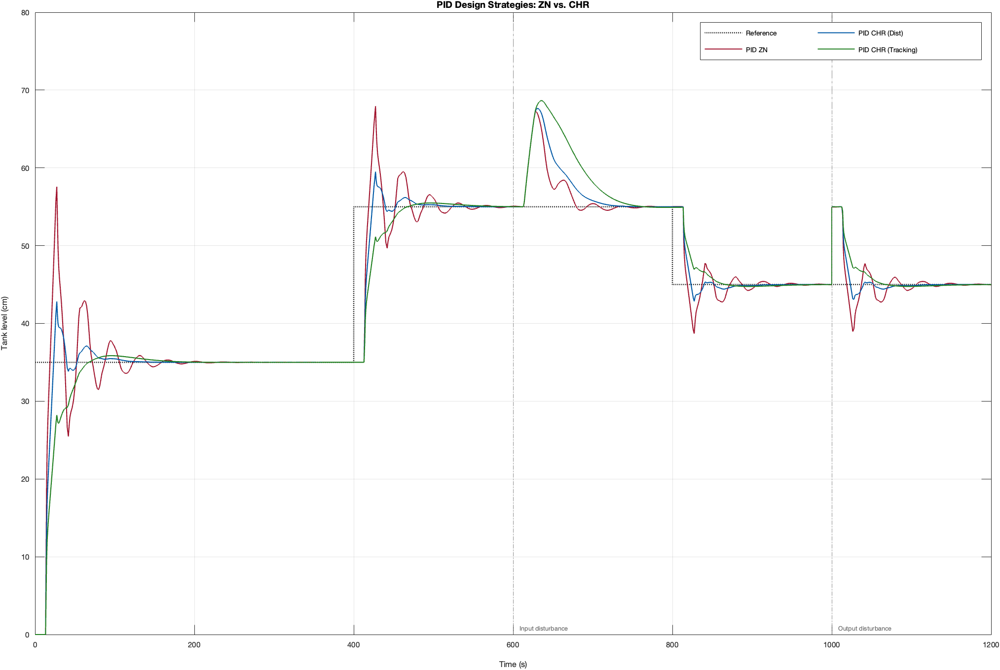
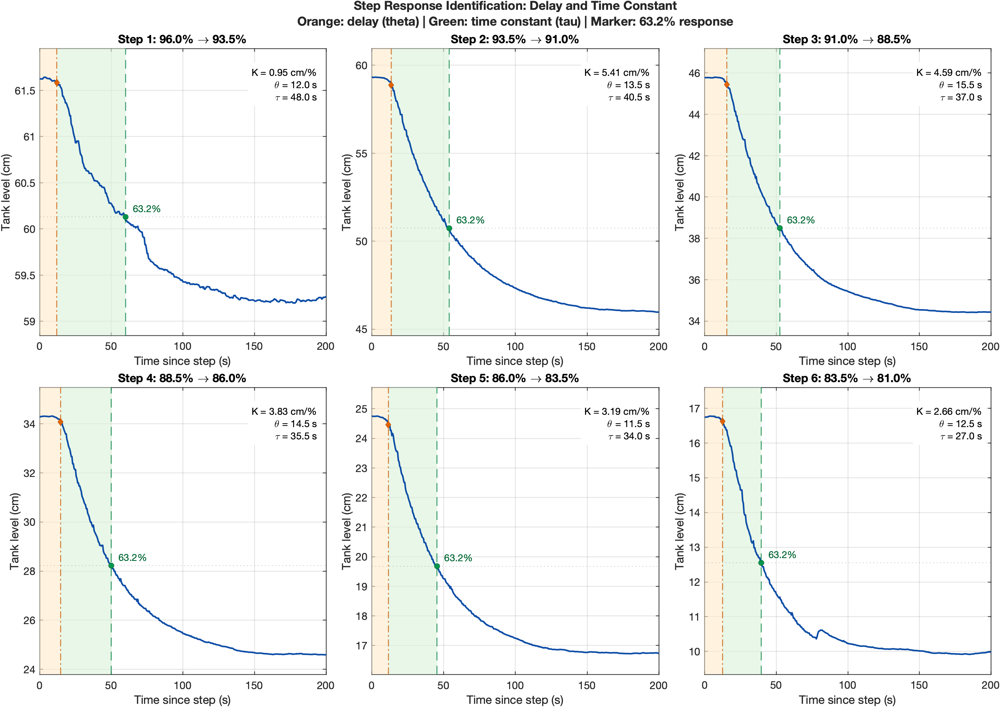
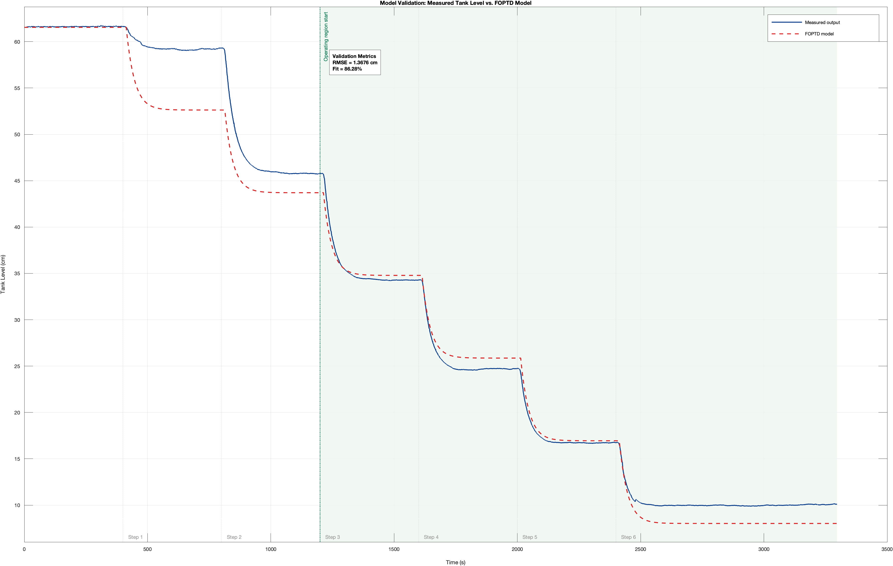
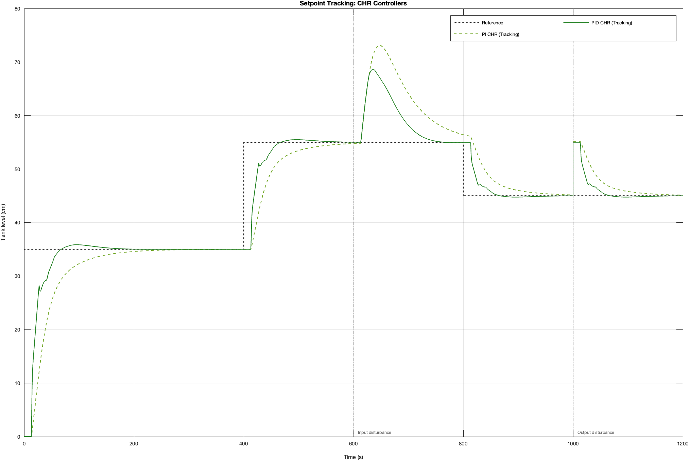

# Tank Level System Identification and PI/PID Control

A MATLAB/Simulink project developed for the **Process Control Laboratory** course. Experimental tank-level data are used to identify a first-order plus time-delay (FOPTD) model, then compare six PI/PID controllers using Ziegler–Nichols and Chien–Hrones–Reswick (CHR) tuning rules.

The repository follows the original laboratory workflow: **measure the process → identify a model → compare control strategies**. It also includes the laboratory models for setpoint weighting and anti-windup.



## Experimental System Identification

The experiment applies six downward steps in valve opening, from 96% to 81%, while recording the tank level in centimetres. For each step, the script estimates:

- **Static gain, K:** the steady-state output change divided by the input change.
- **Delay, θ:** the time until the response reaches 2% of the output change.
- **Time constant, τ:** the interval from the estimated delay to the 63.2% response point.



Steps **3–6** are used as the selected operating region, following the laboratory analysis. Their average parameters define the local FOPTD approximation:

$$
G(s) = \frac{3.5682\,e^{-13.50s}}{33.375s + 1}
$$

| Parameter | Value | Unit |
|---|---:|---|
| Static gain, K | 3.5682 | cm/% |
| Delay, θ | 13.50 | s |
| Time constant, τ | 33.375 | s |
| Validation RMSE | 1.3676 | cm |
| Validation fit | 86.28 | % |

The validation metrics are evaluated from the start of step 3 through the end of the record. The fit reported here is the script's score, `100 × max(0, 1 − RMSE / std(measured level))`, over that interval. The same experimental record is used for identification and validation; this is not a separate test dataset.



The differences outside the selected region illustrate the limits of using a single local model across the full experiment.

Additional views: [steady-state mapping](figures/steady_state_mapping.png), [operating-region and gain analysis](figures/operating_region_analysis.png), [parameters per step](figures/foptd_parameters_per_step.png), and [raw input/output signals](figures/system_step_response.png).

## PI/PID Controller Comparison

Six controllers are compared in Simulink using the identified model, with the time constant rounded to 33.38 s for controller tuning:

| Controller | Kp | Ti (s) | Td (s) |
|---|---:|---:|---:|
| PI — Ziegler–Nichols | 0.6237 | 44.550 | 0 |
| PID — Ziegler–Nichols | 0.8315 | 27.000 | 6.750 |
| PI — CHR, disturbance rejection | 0.4158 | 54.000 | 0 |
| PID — CHR, disturbance rejection | 0.6583 | 32.130 | 5.670 |
| PI — CHR, setpoint tracking | 0.2425 | 40.056 | 0 |
| PID — CHR, setpoint tracking | 0.4158 | 33.380 | 6.750 |

The 1200 s simulation uses a 35 → 55 → 45 cm reference, with reference changes at 400 s and 800 s. An input disturbance is applied at 600 s and an output disturbance at 1000 s.

In this experiment, Ziegler–Nichols PID produces the strongest reference-step overshoot and oscillation. CHR PID for setpoint tracking gives a smoother reference response, while the disturbance-rejection tuning recovers more quickly from the input disturbance. These comparisons apply to the laboratory model and test scenario.



More comparisons: [disturbance rejection](figures/pid_disturbance_rejection.png) and [all six controllers](figures/pid_controller_comparison.png).

The [controller parameter table](results/controller_parameters.csv) is generated by the script. The [performance metrics table](results/controller_performance_metrics_from_report.csv) contains values transcribed from the original laboratory report; it is **not recalculated from each new simulation run**.

## Run the Project

### Software

- MATLAB — the figures in this repository were generated using **R2022a**.
- Control System Toolbox — for transfer functions and model-response simulation.
- Simulink — for the controller-comparison and additional laboratory models.

### 1. Identify and validate the process

The experimental data are not distributed with this repository. To reproduce the identification, create a local `data/` folder and provide data you are authorized to use in the expected format:

- `data/input_level_data.mat`: an `input_level` timeseries (time in seconds, valve opening in percent).
- `data/output_level_data.mat`: an `output_level` timeseries (time in seconds, tank level in centimetres).

The scripts access each timeseries through its `Time` and `Data` properties. Published figures and result tables can be inspected without these files; the controller-comparison script uses the recorded model parameters and does not require the raw data.

Open MATLAB, set the current folder to the repository root, and run:

```matlab
run('src/system_identification.m')
```

This reads the two experimental data files, estimates the model, and saves six figures in `figures/` and three identification/validation tables in `results/`.

### 2. Compare PI/PID controllers

```matlab
run('src/pid_controller_comparison.m')
```

This initializes the six controllers, runs `simulink/pi_pid_control_simulink.slx`, and exports four comparison figures. It also writes the controller parameter table and the reference performance table from the report.

The controller script uses the identified parameters already recorded in the laboratory project; it does not automatically read a newly estimated model from the CSV files. Re-running either script replaces its generated files. Both scripts clear workspace variables and close existing figures when started.

### 3. Explore setpoint weighting and anti-windup

```matlab
run('src/advanced_pid_parameters.m')
open_system('simulink/setpoint_weighting_simulink.slx')
% Or open the anti-windup experiment:
open_system('simulink/anti_windup_simulink.slx')
```

These are additional laboratory models for interactive exploration. The parameter script initializes the advanced-control settings; it does not run these models or export comparison figures automatically. Their results are not included in the reproduced figure set above.

## Repository Contents

```text
tank-level-control-system-identification/
├── README.md
├── requirements.md
├── data/                         # Local data required for identification; Git-ignored
│   ├── input_level_data.mat
│   └── output_level_data.mat
├── src/
│   ├── system_identification.m
│   ├── pid_controller_comparison.m
│   └── advanced_pid_parameters.m
├── simulink/
│   ├── pi_pid_control_simulink.slx
│   ├── setpoint_weighting_simulink.slx
│   └── anti_windup_simulink.slx
├── figures/                      # Exported identification and control plots
└── results/                      # Model, tuning, and performance tables
```

The `data/` directory is local only and excluded from Git; it must be created separately after cloning. The original reports and raw project archive are retained locally in `original/`, which is excluded from Git. Simulink cache files and generated build folders are also ignored.

## Scope

This repository presents a course laboratory project, including its experimental assumptions and original control-design choices. The focus is on documenting the workflow and making the results easy to inspect and reproduce.
